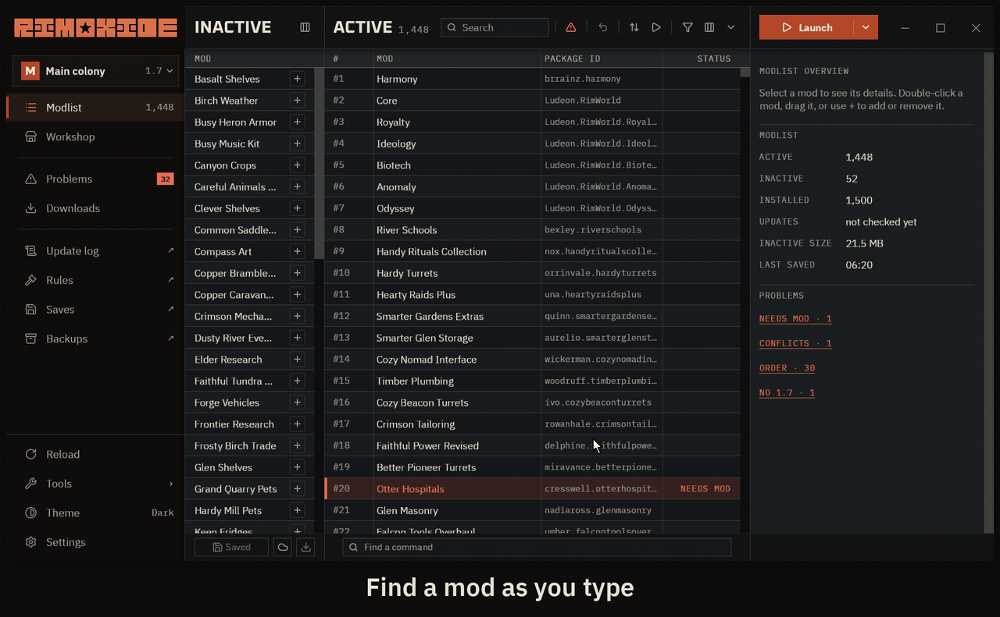
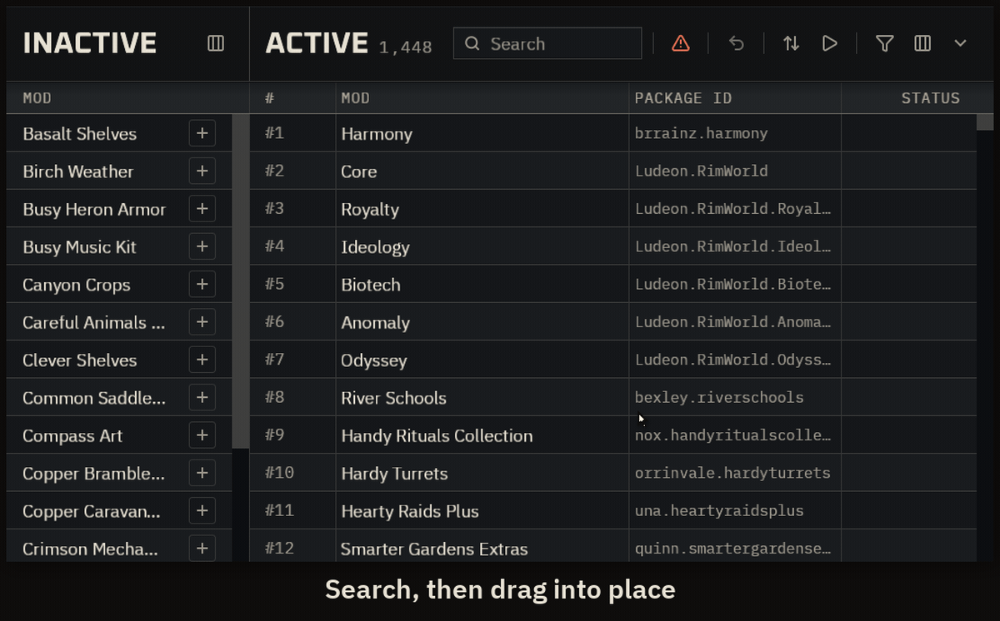
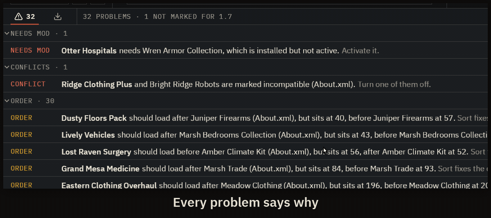
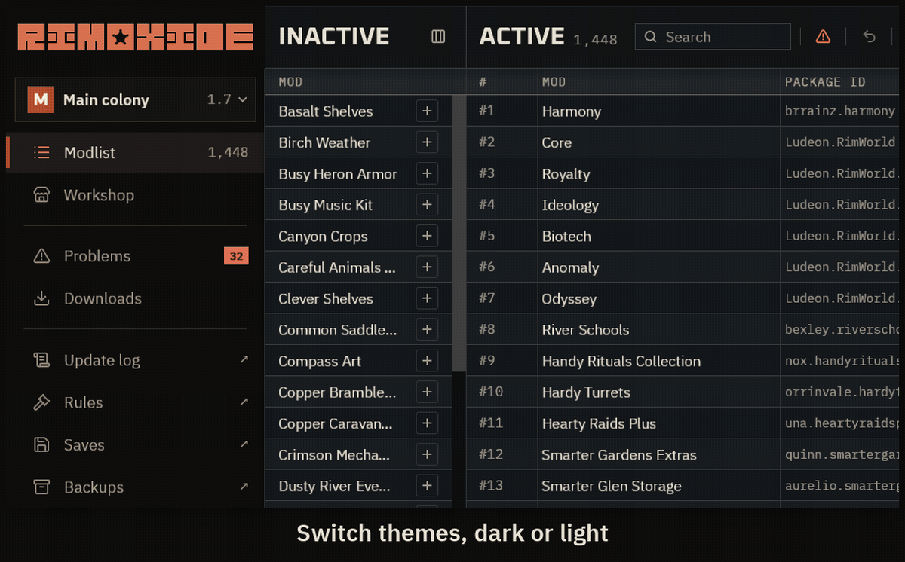
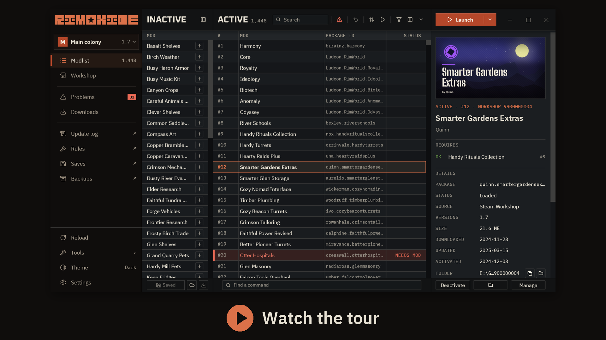
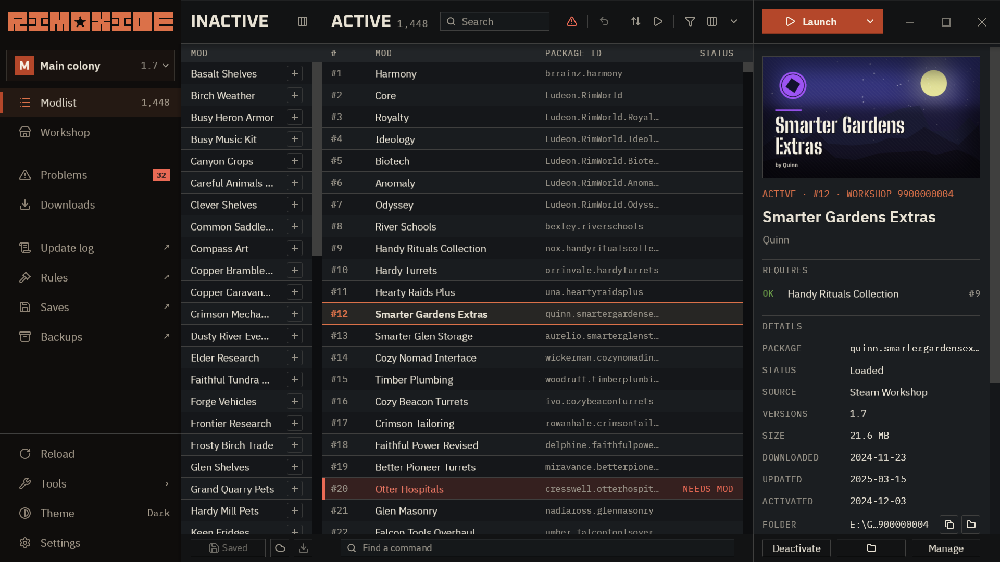
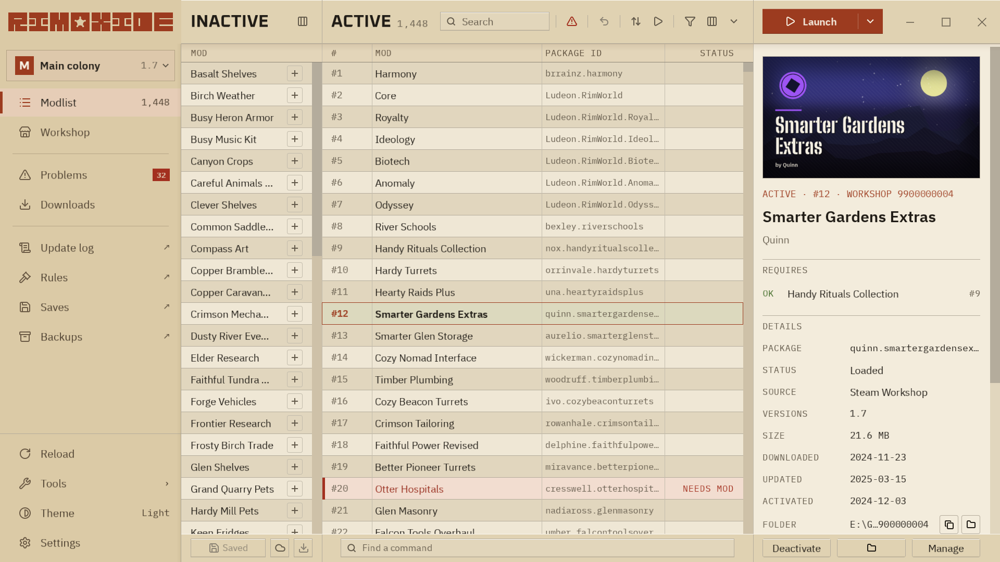
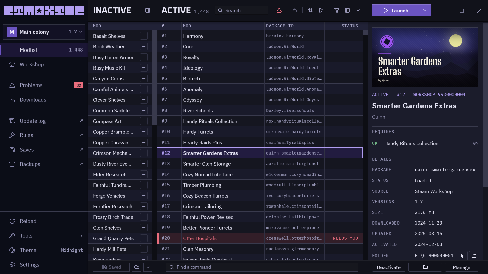
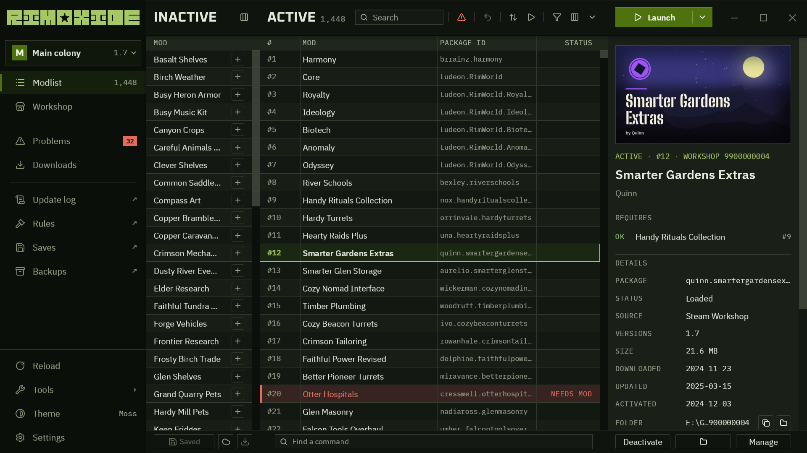

<h1 align="center"></h1>

RimOxide is a free, fast mod manager for RimWorld on Windows, made by the community. It is not official.
It finds your mods, sorts them, keeps named lists, checks them for problems, downloads and updates
Workshop mods, keeps checkpoints of your setup, and starts the game.
You can bring your mod lists, rules and colours over from the mod manager you used before.

  

This is a beta. Back up your saves and mod lists before you use it.

It is an early beta: it is not code-signed and has been tried on two PCs only.

To get it, see [Download](#download) below.

## See it in action

The pictures and the video on this page show an invented modlist.

Search as you type, then drag a mod where it belongs.

Every problem says what is wrong, and its line offers the fix. Sort then clears the load-order lines.

Switch between seven themes, dark or light.

A short tour as a video (MP4, 7 MB). The picture opens the file's page; "View raw" there downloads it:

## Looks

<table>
  <tr>
    <td>
      
    </td>
    <td>
      
    </td>
  </tr>
  <tr>
    <td>
      
    </td>
    <td>
      
    </td>
  </tr>
</table>

The seven themes are Dark, Light, Ashfall, Glacier, Moss, Midnight and Sandstone.
More pictures: [the sort proposal](docs/media/sort-review.png), [the Problems panel](docs/media/problems.png),
[the command palette](docs/media/palette.png) and [the Glacier theme](docs/media/theme-glacier.png).

## Download

Get it from the [Releases page](https://github.com/dcave14/RimOxide-releases/releases), the newest entry at the top.

Pick the file whose name starts with RimOxide- and ends with -windows-x64.zip.
For this beta that is RimOxide-0.9.0-beta.3-windows-x64.zip.
Unzip it into any folder you like and run rimoxide.exe. Nothing is installed.

## Windows may warn you the first time

RimOxide is new and this beta is not code-signed, so Windows does not recognise it yet.

- **"Windows protected your PC"**: click **More info**, check that the app is rimoxide.exe, then click **Run anyway**.
  This comes back for each new version until Windows learns the file.
- **Edge says the file "isn't commonly downloaded"**: open Downloads (Ctrl+J), click the "..." next to the file,
  choose **Keep**, then **Show more** and **Keep anyway**.
- **Smart App Control blocks it with no "Run anyway" button**: Smart App Control allows no unsigned app
  that Microsoft does not know yet, and it has no exception for one app.
  You can see whether it is on in **Settings > Windows Security > App & browser control**.
  While it is on, RimOxide will not run until a signed release exists.
  You can wait for that, or turn Smart App Control off. Recent Windows versions let you turn it back on later.

## Check your download

Only download RimOxide from the Releases page. Before you run it, you can check that your zip is exactly
the one that was published:

1. Open PowerShell in the folder that holds the zip. In File Explorer, type `powershell` in the address bar
   and press Enter.
2. Run `Get-FileHash .\RimOxide-0.9.0-beta.3-windows-x64.zip`, with the name of the zip you downloaded.
3. Compare the long code under **Hash** with the zip's line in SHA256SUMS.txt on the release page, or with
   the "sha256:" value GitHub shows beside the file. Upper and lower case do not matter, but every other
   character must be the same. If they differ, delete the zip and tell us.

## What it needs

- Windows 10 or 11, 64-bit.
- RimWorld, from Steam or not.
- The Workshop tab needs Microsoft Edge WebView2. It is already on Windows 11 and on most Windows 10 PCs.
  If it is missing, install the WebView2 Runtime from Microsoft's website.

## Your data

RimOxide keeps its settings, profiles, checkpoints, logs, the copies of saves it makes
before a launch, the Workshop sign-in and a cache it can always rebuild (among other things
the pictures of mod descriptions) in this folder, wherever rimoxide.exe is:

    %LOCALAPPDATA%\RimOxide

So your data does not travel with the program folder: copying that folder to another PC copies the
program only.
Deleting the program folder does not touch that folder. RimOxide may also keep work files
in a RimOxideData folder at the top of your game's drive, when the game is on another drive,
and checkpoints in a folder you chose yourself.

A profile can have its own folder for RimWorld's settings and saves ("Own settings and
saves" in the profile menu). RimWorld then keeps that profile's settings and saves in the
profile's folder, not in its usual folder. That folder is inside %LOCALAPPDATA%\RimOxide
(in its "p" folder) unless you picked another place in Settings, Game & folders, "Folder for
profile settings and saves". A profile that goes back to the shared settings, or is deleted
with "Delete profile, keep its folder", leaves its folder on disk, listed under "Kept
folders" in the same part of Settings.

When a profile uses one of two Workshop copies of a mod, RimOxide places that copy in the
game's Mods folder, in a folder named by the Workshop item's number. Pinned versions and
mods downloaded through SteamCMD are put in Mods too. Every folder RimOxide put in Mods holds
a small file named .rimoxide-owned.json. Settings, Protection lists the copies it placed.

### Removing RimOxide

To remove the program, delete the folder that holds rimoxide.exe.

Before you remove your data, keep what you want from it. A profile's own saves are in its
folder: in Settings, Game & folders, press "Open folder" beside the profile and copy that
folder somewhere else. Then close RimOxide and delete %LOCALAPPDATA%\RimOxide.
This cannot be undone: it permanently removes your checkpoints, profiles, settings, the
copies of saves made before launches, the Workshop sign-in and, for every profile whose own
folder is in there, that profile's RimWorld settings and saves.

RimOxide does not touch the saves and ModsConfig.xml in RimWorld's own folder when you
remove it. Copies of mods it placed in the game's Mods folder stay there: they are ordinary
mod folders (each holds .rimoxide-owned.json) and may be deleted by hand if you no longer
want them. A RimOxideData folder, if there is one, also stays.

## Updating

RimOxide tells you when a newer version is out. You can turn this off in Settings, About, "Check for new versions".

To update, download the new zip and replace rimoxide.exe. Do not go back to an older beta after using
a newer one.

## Privacy

RimOxide has no accounts, no telemetry and no crash upload. It contacts only these:

- Valve's Steam services: Workshop details by item number (Steam's web API), the Workshop
  pages you open in the Workshop tab (Steam's community, store and sign-in sites), Steam's
  image servers, and Valve's download server if you choose SteamCMD. Workshop downloads and
  subscriptions go through your own Steam client.
- GitHub: the community sort rules and the Workshop database, updates of the Filter Plus
  extension, and the check for a new RimOxide version. Once a day RimOxide asks GitHub for
  the newest version number. GitHub sees your IP address, the time and the name "RimOxide".
  Nothing else is sent. You can switch it off in Settings, About, "Check for new versions".
- The Workshop tab's extra details come from a small service run by RimOxide's author. It
  receives the Workshop item numbers on the page and, like any website, your IP address.
  It keeps no account and no mod list.
- Pictures in mod descriptions. When you look at a mod, RimOxide shows the pictures in its
  description. By default ("Steam images only") it loads only pictures kept on Steam's own
  image servers. Pictures kept anywhere else load only if you choose "All images"; "No
  images" loads none. You change this with the gear beside the description, or in Settings,
  Appearance, "Images in descriptions". Whoever hosts a picture sees your IP address, as when
  you open the mod's Workshop page. The request carries the picture's address and an
  ordinary-browser identification, nothing else: no cookie, nothing that names you. Loaded
  pictures are kept in the cache folder inside RimOxide's data folder.
- The Workshop tab uses Microsoft Edge WebView2, which includes Microsoft Defender
  SmartScreen and sends information to Microsoft as described in Microsoft's Privacy
  Statement (https://aka.ms/privacy).

RimOxide never sends your mod list, profiles, saves, logs or file paths.

## Known issues

- Windows may warn you the first time, and with Smart App Control on, RimOxide will not run.
- Checkpoints are optional backups. The first one of a big setup is slow; later ones are quick.
  Starting RimOxide is not affected.
- Some newer features, such as playing from a restored profile, are still being proven.

The full list is in [KNOWN-ISSUES.md](KNOWN-ISSUES.md).

## Report a problem

Report problems on the [Issues page](https://github.com/dcave14/RimOxide-releases/issues/new/choose) with the bug form.
Attach the log files. In RimOxide open Settings, About, and press "Open logs folder".
session.log is always there: a few lines per session (start, the game found or not, messages shown,
finished downloads, saves, launches and exit), with counts but never your mod list.
The other logs appear only when something went wrong: panic-*.log after a crash, stalls.log after
a slow moment, downloads.log after a failed download.
These files can show your Windows user name and your mod names: look them over before you post them.
Never share the workshop-browser folder: it holds your Steam sign-in.

For a security problem, read [SECURITY.md](SECURITY.md) first and do not post the details in public.

## Steam

Workshop actions (subscribe, unsubscribe and download) go through the Steam program on your PC and the
Steam library that came with your game. Valve has not approved or reviewed RimOxide.
Every Steam action starts with your click.

## Licence

RimOxide is free to download, use and pass on unchanged.
You may not change it, take it apart or reuse parts of it.
The full terms are in [LICENSE.txt](LICENSE.txt), here and inside the zip.
RimOxide's source code is not published.
The parts made by others keep their own licences: see [THIRD-PARTY-NOTICES.md](THIRD-PARTY-NOTICES.md) here
and THIRD-PARTY-LICENSES.txt inside the zip.

Sharing is allowed. A link to this page is kinder than a re-upload, because people then get the newest version.

## Not official

RimOxide is a free community tool. It is not official and is not endorsed by Ludeon Studios Inc.
Portions of the materials used to create this content/mod are trademarks and/or copyrighted works of Ludeon Studios Inc.
All rights reserved by Ludeon.
This content/mod is not official and is not endorsed by Ludeon.
RimWorld is a trademark of Ludeon Studios Inc.

RimOxide is not affiliated with, endorsed by, or sponsored by Valve Corporation.
Steam and the Steam logo are trademarks and/or registered trademarks of Valve Corporation in the U.S. and/or other countries.
